# Architecture

## 6. Plane separation and staleness windows

### Trust boundaries (diagram 03)

Each trust zone is its own SPIFFE trust domain. The two domains meet only through the attested
channel and a TRAIN verdict; they are never merged. Data-plane calls into the management plane are
denied by default, and a workload without an SVID or running an unsigned image cannot join or
start. The demonstrator cluster (IONOS) is drawn as its own grouping outside both trust domains: it
holds the observability backends, a recorded placement
([Observability placement](#observability-placement-zt-55-zt-26)), and each zone's management plane
has one outward edge to it, the ZT-26 observability export. No edge leads from it into a zone.

Source: [`diagrams/03-trust-boundaries.mmd`](diagrams/03-trust-boundaries.mmd).

### Allow matrix (data plane → management plane)

Default DENY at both layers: the Kubernetes network policy layer and the mesh AuthorizationPolicy
layer. ZT-55 names the *Kubernetes network policy layer*, a layer and not a resource kind: in the
zones it is enforced by Cilium, through Kubernetes `NetworkPolicy` objects and, where a source is
not a pod, `CiliumNetworkPolicy` objects. These are the only permitted paths:

| From data-plane workload → | Allowed? | Layer that enforces |
|---|---|---|
| PDP adapter → TSA policy engine | ALLOW (mTLS, named pair) | mesh policy |
| aTLS gateway → cmcd / TCR resolve | ALLOW (named pair) | mesh policy |
| workloads → OTel collector (export only) | ALLOW (declared bypass, ZT-26) | mesh policy, egress-restricted |
| workloads → DNS | ALLOW (declared bypass) | network policy layer, the resolver's port (53; 8053 on the Gardener clusters) |
| anything else data → management (SPIRE server, ArgoCD, OpenBao, TSPA, Harbor, estserver, admin APIs) | **DENY** | both layers; ZT-55 matrix test |

### Declared openings of the network baseline

Beside the DNS bypass, the network baseline of a meshed zone has five declared openings for the two
control planes: the identity control plane (`spire-system`) and the mesh control plane
(`istio-system`), both management-plane namespaces under the default deny. They are entries of the
**cluster-administration** class of the Zero Trust Connector bypass list (ZT-26: administrative
APIs), each listed with its reason; they are not rows of the allow matrix, which governs paths from
data-plane workloads into the management plane and whose catch-all denial still holds. In
particular a data-plane workload reaches the SPIRE server on no port. Each opening is rendered by
the umbrella chart only when the zone file enables it, and is proven by the named check of the
mesh identity proof, which every run records (see `scripts/verify-mesh-identity/README.md`):

| Opening | Source | Destination | Port | Network policy layer | Proving check |
|---|---|---|---|---|---|
| `meshControlPlane` | pods of every plane namespace with the mesh label | istiod (`istio-system`) | 15012 (xDS) | egress in the source namespaces, ingress in `istio-system` (Kubernetes `NetworkPolicy`) | `control-planes-under-default-deny` (proxies SYNCED; no other istiod port reachable) |
| `controlPlaneWebhooks` | the API server (entities `kube-apiserver`, `host`, `remote-node`); where the zone names it, the provider's pod that relays the API server's calls (`fromEndpoints`; Gardener's `vpn-shoot` on zone A and zone B) | istiod's webhook; the SPIRE controller-manager's webhook | 15017; 9443 | ingress in `istio-system` and `spire-system` (`CiliumNetworkPolicy`) | `control-planes-under-default-deny`, `install-order-idempotent` (injection and admission work) |
| `identityServer` | the SPIRE agents on the host network (entities `host`, `remote-node`) | the SPIRE server | 8081 | ingress in `spire-system` (`CiliumNetworkPolicy`) | `control-planes-under-default-deny` (every agent attested) |
| `kubeApi` | pods of the management-plane namespaces | the API server (entity `kube-apiserver`) | the API server's port | egress in each management-plane namespace (`CiliumNetworkPolicy`) | `install-order-idempotent` (the controllers reconcile) |
| `observabilityScrape` | the zone gateway's pods (management namespace) | the SPIRE server and the controller-manager (`spire-system`), through the Service `spire-server-metrics` | 9988; 8082 | egress in the management namespace, ingress in `spire-system` (Kubernetes `NetworkPolicy`) | `spire-lane-is-narrow`, `spire-server-scraped` of `scripts/verify-observability/verify.sh` (the registration port stays refused) |

The sources of the last three are not pods, so they are expressed as Cilium entities rather than
addresses ([Workload identity](workload-identity.md#openings-under-the-default-deny)). The sidecar
reaches its SPIRE agent over a mounted socket and the agent reaches the kubelet over the host's
loopback, so neither needs an opening.

### Observability placement (ZT-55, ZT-26)

The observability stack is one management-plane role with two placements
([ADR-0012](adr/0012-central-observability-backends.md)):

| Role | Placement | Services | Reached from the data plane |
|---|---|---|---|
| Observability stack | the collectors, in each participant zone's management plane | the node collectors (`ztd-otel-node`, host network, no mesh) and the zone gateway (the management namespace, meshed, with its own SVID) | through the zone gateway only, on 4317 and 4318, along the row workloads → OTel collector |
| Observability stack | the backends, on the demonstrator cluster, outside both trust domains | the receiving collector (the entry), Prometheus, Alertmanager, Jaeger; the log store is an open point | never: a data-plane workload has no path to the demonstrator cluster, and the zone's egress policy refuses one |

**Declared bypasses of the observability export class (ZT-26).** ZT-26 lets observability APIs bypass
the Zero Trust Connector, each with its own ingress and egress configuration. Two paths carry this
class; each bypasses the Connector only, not the mesh and not the network layer:

- **workloads → zone gateway** (the allow-matrix row above): mesh mTLS by SVID, the network policy
  limited to the gateway's export ports.
- **zone → demonstrator cluster** (the telemetry export): starts in the management plane, so it is
  outside the allow matrix. Its controls: in the zone, an egress policy that lets the zone gateway reach
  the demonstrator cluster's entry address and port and no other external destination
  (`allow-telemetry-export-egress`); the node collectors, on the host network where no pod policy
  applies, name the entry as their only exporter; mutual TLS 1.3 with one client certificate per zone,
  the zone taken from the listener the certificate completes, never from the client's data; on the
  demonstrator cluster, a `LoadBalancer` restricted to the zones' egress addresses with the per-zone
  listeners only, and an ingress policy to the same. It carries telemetry outward only: nothing on the
  demonstrator cluster opens a connection into a zone. During the contingency period it runs over
  public transit; after the move, over the CUG interconnect ([Specifications](specifications.md)).

**Out of scope: collection initiated from the management plane.** Paths initiated from the management
plane are outside the allow matrix, because ZT-55 governs reachability from the data plane, so the
matrix models that direction only. Two such paths exist, and saying nothing about them would make the
matrix look as if it modelled one direction without a reason:

- the zone gateway's scrapes of the SPIRE server and the controller-manager, the declared opening
  `observabilityScrape` above;
- the zone gateway's and the node collectors' export of telemetry out of the zone to the demonstrator
  cluster, the declared bypass above, with its own egress control.

Metrics are pushed from the zones, never pulled into them: the central Prometheus scrapes no target in
a zone.

### Staleness matrix

Maximum window in which a revoked or rotated artefact still authorises. All values are proposed.

| Artefact | Rotation/lifetime | Cache | Max stale-authorisation window |
|---|---|---|---|
| SVID | 1 h TTL | in-process | ≤ 1 h (mesh) |
| Keycloak/issuer JWKS | rotate on demand | guard cache 5 min | ≤ 5 min |
| Access token | 300 s lifetime | — | ≤ 300 s after revocation of its basis |
| Policy bundle | poll 60 s | TSA cache | ≤ 60 s |
| Trust list / measurement | TTL 300 s | TCR/gateway | ≤ 300 s + channel lifetime 15 min ⇒ ≤ ~20 min for an established channel (bounded by channel re-establishment) |
| Credential revocation | checked per verification | outcome TTL 120 s | ≤ renewal interval (≤ token lifetime 300 s) + 120 s |
